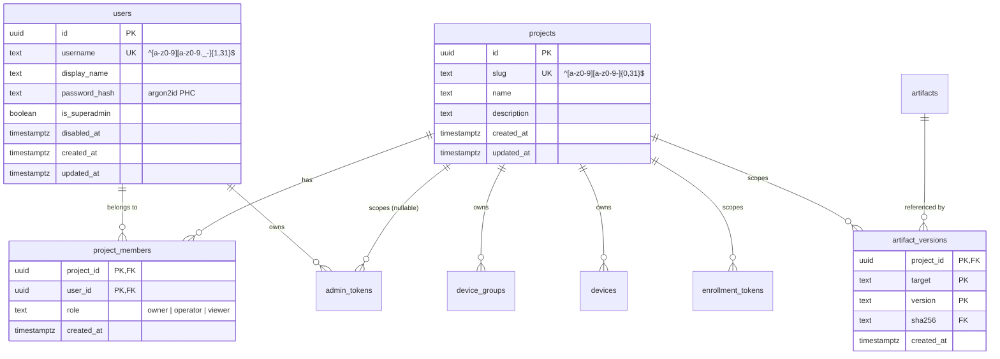

# Projects, Multi-User Auth & Scoped Tokens (Option A)

**Priority:** P1
**Target:** Post-v1 / V2 Foundation (Multi-Project & Collaborator Scale)
**Depends on:** Admin Authentication (`R0-be-1`), Artifact Versioning (`R1-be-1`), Device Registry (`R0-be-4`)
**Touches CRITICAL paths:** `alembic/versions/`, `src/fleetforge/db/models.py` (`admin_tokens`, `enrollment_tokens`), `src/fleetforge/api/deps.py`, `src/fleetforge/api/routers/enroll.py`

## Overview

Scale a single Fleetforge deployment from **one admin + one flat fleet** to **multiple human users, multiple isolated projects, and project-scoped CI/machine tokens**—without changing a single byte of ESP32 firmware or the frozen `proto: 1` wire contract (`spec/device-protocol.md`).

Today, running two projects on one server (for example, `epaper-frame` and `caelus-scout`) hits three immediate walls:
1. **Shared version namespace:** `artifact_versions` has primary key `(target, version)`. Uploading `esp32s3` `1.0.0` for a rover collides (`409 Conflict`) with `esp32s3` `1.0.0` for an e-paper frame, and the dashboard offers the rover's firmware in the frame's deploy dropdown.
2. **One shared password, no collaborators or CI tokens:** `POST /v1/auth/login` verifies a single environment variable (`ADMIN_PASSWORD_HASH`) and issues a browser cookie. Teammates share one credential, `sent_by.subject` is always `"admin"`, and CI pipelines have no way to mint a project-scoped `Bearer ffa_...` token.
3. **Flat global fleet view & SSE stream:** Every user and every open browser tab sees every board, every enrollment token, and every `ff_events` notification across all projects.

Option A solves all three in the control plane while keeping the MQTT broker, content-addressed blob store, and device protocol unchanged.

---

## Core Architectural Decisions

### D1. The device wire protocol (`proto: 1`) and MQTT ACLs do not change
A board flashed at R0 speaks `ff/v1/d/{device_id}/up/*` and `ff/v1/d/{device_id}/dn/*` with `mqtt_username == device_id` for life (`spec/device-protocol.md`). Project membership is a **control-plane fact** recorded in PostgreSQL when the board burns its project-scoped `enrollment_token` at `POST /v1/enroll`. The board never knows its `project_id`, and `mosquitto/acl` stays two pattern lines.

### D2. Content-addressed blobs stay global; version labels become per-project
`artifacts` (`sha256` PK) and object-store keys (`blobs/sha256/<hex>`) describe immutable bytes and remain global across the instance—uploading identical bytes in two projects stores one object in GCS/MinIO. `artifact_versions` changes its primary key from `(target, version)` to `(project_id, target, version)`. Because `POST /v1/devices/{device_id}/deploy` resolves the version against `device.project_id` and `device.platform_type`, **a board can structurally only ever be deployed firmware uploaded to its own project.**

### D3. Seeded `"default"` project and zero-breakage defaults (Drop & Recreate DB)
Rather than writing an in-place data-backfill migration, the database is dropped and recreated cleanly with the target DDL in place:
- The schema seeds a `"default"` project (`slug = 'default'`, `name = 'Default'`) at creation time, and `project_id` is `NOT NULL` from `CREATE TABLE` on `devices`, `device_groups`, `artifact_versions`, and `enrollment_tokens` (and `server_default` or resolved to `'default'` when omitted by internal helpers).
- Any API call to a collection endpoint (`GET /v1/devices`, `POST /v1/artifact`, `GET /v1/artifact`, `POST /v1/enrollment-tokens`, `GET /v1/enrollment-tokens`, `GET /v1/events`) that omits `?project=<slug>` defaults to:
  1. the token's pinned project if the caller presents a project-pinned `ffa_` token, or
  2. `"default"` otherwise.
- Every existing test, CLI script, and simulator recipe that omits `?project=` continues to pass without edits.

### D4. Local `users` table bootstrapped from `ADMIN_PASSWORD_HASH`
- A new `users` table stores human accounts (`username`, `password_hash`, `is_superadmin`, `disabled_at`).
- `POST /v1/auth/login` accepts `{"username": "admin", "password": "..."}` where **`username` defaults to `"admin"` when omitted**.
- When `username == "admin"` and no `"admin"` row exists in `users` yet (or when `ADMIN_PASSWORD_HASH` is configured in `Settings`), the login path verifies against `users` (if present) or `Settings.admin_password_hash` (bootstrapping/syncing the `admin` superadmin row automatically). Existing tests and runbooks that POST `{"password": "..."}` with only `ADMIN_PASSWORD_HASH` set in the environment work unchanged.

### D5. Cross-project MAC hijacking is refused at `POST /v1/enroll`
In single-tenant v1 (`registry.py`), `enroll_device` upserted any `device_id` because one operator owned every token. With multiple projects, a user holding a valid enrollment token for Project B must not be able to steal a live board (`decommissioned_at IS NULL`) currently enrolled in Project A by calling `POST /v1/enroll` with Project A's `device_id`.
- **Rule:** Re-enrolling an existing `device_id` succeeds iff `existing.project_id == token.project_id` **or** `existing.decommissioned_at IS NOT NULL`. Otherwise `POST /v1/enroll` refuses with `409 Conflict` (`"device is enrolled in another project; decommission or transfer it first"`) **before** burning the token.

### D6. `device_groups` become per-project release rings / tags
With `projects` owning the boundary between unrelated fleets (`caelus-ugv`, `epaper-frame`), `device_groups` now belong to a project (`project_id NOT NULL`, `UNIQUE (project_id, name)`). Inside a project, groups represent release rings (`bench`, `canary`, `prod`) or sub-fleets (`ugv-base`, `uav-scouts`).

---

## Schema Design (Clean Recreate — No Data Backfill Migration)

Follows `src/fleetforge/db/models.py` conventions: `TIMESTAMPTZ` everywhere, plain `TEXT` with regex `CheckConstraint`s for slugs/identifiers, and advisory `StrEnum`s in Python. Because the database can be dropped and recreated (`just db-reset` / `recreate_database`), the tables are defined directly with their final `NOT NULL` columns, primary keys, and foreign keys in the initial DDL (`0001_initial_schema.py` / `0004_artifact_versions.py`), with no multi-step `ALTER TABLE` backfill migration.



### 1. New Tables

#### `projects`
| Column | Type | Constraints | Notes |
|---|---|---|---|
| `id` | `UUID` | `PRIMARY KEY DEFAULT gen_random_uuid()` | Stable surrogate key |
| `slug` | `TEXT` | `NOT NULL UNIQUE`, `CHECK (slug ~ '^[a-z0-9][a-z0-9-]{0,31}$')` | URL/CLI handle (`default`, `caelus`, `epaper`). Reject, never normalise |
| `name` | `TEXT` | `NOT NULL` | Human display title |
| `description` | `TEXT` | `NULL` | Optional context |
| `created_at` | `TIMESTAMPTZ` | `NOT NULL DEFAULT now()` | Server receipt time |
| `updated_at` | `TIMESTAMPTZ` | `NOT NULL DEFAULT now()` | |

*Seeded row at schema creation:* `id = '00000000-0000-4000-8000-000000000001'`, `slug = 'default'`, `name = 'Default'`. Using a fixed, well-known UUID constant (`DEFAULT_PROJECT_ID`) for the seeded `'default'` project means `project_id` on `devices`, `device_groups`, `enrollment_tokens`, and `artifact_versions` can carry `server_default=text("'00000000-0000-4000-8000-000000000001'::uuid")`—so raw SQL inserts in existing unit tests (`INSERT INTO devices (device_id, ...)`) work out of the box without touching a single existing test file.

#### `users`
| Column | Type | Constraints | Notes |
|---|---|---|---|
| `id` | `UUID` | `PRIMARY KEY DEFAULT gen_random_uuid()` | |
| `username` | `TEXT` | `NOT NULL UNIQUE`, `CHECK (username ~ '^[a-z0-9][a-z0-9._-]{1,31}$')` | Lowercase handle (`admin`, `tvaroska`). Becomes `admin_tokens.subject` on login |
| `email` | `TEXT` | `NULL UNIQUE`, `CHECK (email IS NULL OR email ~ '^[a-z0-9._%+-]+@[a-z0-9.-]+\.[a-z]{2,}$')` | Lowercase email address for invite-only Firebase Auth |
| `firebase_uid` | `TEXT` | `NULL UNIQUE`, `CHECK (firebase_uid IS NULL OR length(firebase_uid) BETWEEN 1 AND 128)` | Bound automatically on the user's first Firebase login |
| `display_name` | `TEXT` | `NULL` | Optional human name |
| `password_hash` | `TEXT` | `NULL` | Argon2id PHC string (`fleetforge.auth.hashing`); nullable for Firebase-managed invitees |
| `is_superadmin` | `BOOLEAN` | `NOT NULL DEFAULT false` | Full access to all projects + `/v1/users` and `/v1/projects` creation |
| `disabled_at` | `TIMESTAMPTZ` | `NULL` | Soft disable; login and existing tokens immediately rejected in `require_admin` |
| `created_at` | `TIMESTAMPTZ` | `NOT NULL DEFAULT now()` | |
| `updated_at` | `TIMESTAMPTZ` | `NOT NULL DEFAULT now()` | |

#### `project_members`
| Column | Type | Constraints | Notes |
|---|---|---|---|
| `project_id` | `UUID` | `PRIMARY KEY`, `FK -> projects.id ON DELETE CASCADE` | |
| `user_id` | `UUID` | `PRIMARY KEY`, `FK -> users.id ON DELETE CASCADE` | |
| `role` | `TEXT` | `NOT NULL`, `CHECK (role IN ('owner', 'operator', 'viewer'))` | Server-authored vocabulary (`ProjectRole(StrEnum)`) |
| `created_at` | `TIMESTAMPTZ` | `NOT NULL DEFAULT now()` | |

### 2. Altered Existing Tables

| Table | Change | Constraint / Index Change |
|---|---|---|
| `admin_tokens` | Add `user_id UUID NULL FK -> users.id ON DELETE CASCADE`<br>Add `project_id UUID NULL FK -> projects.id ON DELETE CASCADE` | `project_id IS NULL` = user session (accesses all projects the user is a member of) or superadmin token. `project_id IS NOT NULL` = machine/CI token pinned to one project. |
| `device_groups` | Add `project_id UUID NOT NULL FK -> projects.id ON DELETE CASCADE` | Drop global `UNIQUE (name)`; add `UNIQUE (project_id, name)` and index `(project_id)`. |
| `devices` | Add `project_id UUID NOT NULL FK -> projects.id ON DELETE RESTRICT` | Add index `ix_devices_project_id (project_id)`. Live board `name` uniqueness in `PATCH /v1/devices/{id}` becomes scoped to `project_id`. |
| `enrollment_tokens` | Add `project_id UUID NOT NULL FK -> projects.id ON DELETE CASCADE` | Add index `ix_enrollment_tokens_project_id_created_at (project_id, created_at DESC)`. |
| `artifact_versions` | Add `project_id UUID NOT NULL FK -> projects.id ON DELETE RESTRICT` | Drop PK `(target, version)` and index `ix_artifact_versions_target_created_at`; add PK `(project_id, target, version)` and index `ix_artifact_versions_project_target_created_at (project_id, target, created_at)`. |

> **What stays global on purpose:**
> - `artifacts` (`sha256` PK): content-addressed immutable bytes.
> - `partition_profiles` (`partition_table_sha256` PK): physical flash-map measurements (`ab-4m-v1`, `ab-4m-arduino-v1`). Adding, adopting or deleting a partition profile is a superadmin action only (S0-sec-2): the table has no project, so a write changes every project's deploy gate.
> - `device_progress`, `deploy_events`, `device_faults`, `device_logs`, `device_telemetry`, `device_metrics`, `device_commands`: already keyed by `device_id` (which belongs to exactly one `project_id`), avoiding redundant `project_id` denormalization across high-volume time-series tables.

---

## Authorization & RBAC Model

### 1. Roles (Human Users on a Project)

| Action | `viewer` | `operator` | `owner` | `is_superadmin` |
|---|:---:|:---:|:---:|:---:|
| View devices, health, logs, telemetry, artifacts, SSE (`/v1/events`) | Yes | Yes | Yes | Yes |
| Dry-run deploy precheck (`POST /v1/devices/{id}/deploy/precheck`) | Yes | Yes | Yes | Yes |
| Upload artifacts (`POST /v1/artifact`) | — | Yes | Yes | Yes |
| Deploy / apply / cancel / rollback / reboot (`POST /v1/devices/{id}/...`) | — | Yes | Yes | Yes |
| Issue & revoke enrollment tokens (`POST /v1/enrollment-tokens`) | — | Yes | Yes | Yes |
| Rename device / assign group (`PATCH /v1/devices/{id}`) | — | Yes | Yes | Yes |
| Manage project groups (`POST/PATCH/DELETE /v1/groups`) | — | — | Yes | Yes |
| Manage project members & project-scoped tokens | — | — | Yes | Yes |
| Transfer or decommission a device | — | — | Yes | Yes |
| Create/delete projects, manage `users`, adopt `partition_profiles` | — | — | — | Yes |

### 2. Scopes (`AdminToken.scopes`)

`require_admin` in `src/fleetforge/api/deps.py` remains the single verification entrypoint, returning an enriched `AuthContext`:

```python
@dataclass(frozen=True, slots=True)
class AuthContext:
    token_id: uuid.UUID
    subject: str
    scopes: tuple[str, ...]
    expires_at: dt.datetime | None
    user_id: uuid.UUID | None = None
    project_id: uuid.UUID | None = None
    is_superadmin: bool = False
```

A token's effective permission on a target `project_id` is checked by a small dependency helper `require_project_access(min_role / required_scope)`:
1. **Token pin check:** If `auth.project_id is not None` and `auth.project_id != target_project.id`, reject with `403 Forbidden` (or `404` when hiding existence).
2. **Scope check (for machine/CI tokens):**
   - `"admin"` in `auth.scopes` grants full access (preserves v1 tokens).
   - Otherwise, check fine-grained scopes: `"read"` (GETs + precheck), `"write:artifacts"` (upload), `"deploy"` (deploy + device verbs), `"enroll"` (issue/revoke enrollment tokens).
3. **User membership check (when `auth.user_id` is set):**
   - Verify `user.disabled_at is None` (cached alongside row read in `require_admin`).
   - If `user.is_superadmin`, allow.
   - Otherwise look up `(target_project.id, auth.user_id)` in `project_members` and verify `role >= min_role`.

---

## API Surface Specification

### 1. Auth & Scoped Machine Tokens (`/v1/auth`)

| Endpoint | Method | Auth | Description |
|---|---|---|---|
| `/v1/auth/login` | `POST` | Public (rate-limited) | Body: `{"username": "admin" \| "alice@example.com", "password": "..."}`. Verifies local `password_hash` or (when `FIREBASE_WEB_API_KEY` is configured) Firebase Email + Password (`accounts:signInWithPassword`, then `accounts:lookup`) for invited users. A Firebase identity whose email is not verified gets `403` "this email address has not been verified". Sets `ff_session` cookie. |
| `/v1/auth/firebase` | `POST` | Public (rate-limited) | Body: `{"id_token": "<firebase_jwt>"}`. Needs both `FIREBASE_PROJECT_ID` and `FIREBASE_WEB_API_KEY` (else `503`). Verifies the RS256 Firebase ID token (signature, `aud`, `iss`, `sub`, `auth_time`), checks revocation via `accounts:lookup` (disabled account or `auth_time < validSince` -> `401`), refuses an unverified email (`403`), enforces invite-only membership in `users` (or bootstrap `FIREBASE_SUPERADMIN_EMAILS`), binds `firebase_uid` (looked up by uid first, then email), and sets `ff_session` cookie. |
| `/v1/auth/logout` | `POST` | Any token | Revokes presenting token, clears cookie. |
| `/v1/auth/me` | `GET` | Any token | Returns `token_id`, `subject`, `scopes`, `expires_at`, plus `is_superadmin`, `project_id`, and `projects: [{slug, name, role}]`. |
| `/v1/auth/tokens` | `POST` | User session / `owner` | Issues a named `ffa_...` token (optional `project` slug, `scopes`, `expires_in_days`). Plaintext returned **once**. From an unpinned session only; a project-pinned token cannot mint (S0-sec-2). |
| `/v1/auth/tokens` | `GET` | User session / `owner` | Lists active/revoked tokens for the caller (or project). Never returns secret hashes. |
| `/v1/auth/tokens/{id}/revoke` | `POST` | User session / `owner` | Conditional `UPDATE ... SET revoked_at = now()`, evicts from `token_cache`, returns `204`. |

**CLI counterpart:** `python -m fleetforge.auth issue-token --name "github-actions" --project caelus --scope read --scope write:artifacts --scope deploy` prints the `ffa_...` token to stdout.

### 2. Projects & Members (`/v1/projects` & `/v1/users`)

| Endpoint | Method | Auth | Description |
|---|---|---|---|
| `/v1/projects` | `GET` | Any token | Lists projects visible to the caller (all for superadmin, member projects for users, single pinned project for project-scoped token). |
| `/v1/projects` | `POST` | Superadmin | Creates a project (`slug`, `name`, `description`). `201 Created`. |
| `/v1/projects/{slug}` | `PATCH` | Project `owner` / Superadmin | Updates `name` or `description` (`slug` is immutable once created). |
| `/v1/projects/{slug}/members` | `GET` | Project `viewer`+ | Lists members (`username`, `display_name`, `role`). |
| `/v1/projects/{slug}/members/{username}` | `PUT` | Project `owner` / Superadmin | Adds or updates a member's `role` (`owner`, `operator`, `viewer`). |
| `/v1/projects/{slug}/members/{username}` | `DELETE` | Project `owner` / Superadmin | Removes member from project (refuses removing the last `owner`). |
| `/v1/users` | `GET`, `POST` | Superadmin | Lists or creates human users (`username`, `email`, `display_name`, `password`, `is_superadmin`, `send_invite_email`). With `send_invite_email`, creates the Firebase account server-side (`accounts:signUp`, random discarded password) and sends the `PASSWORD_RESET` setup email; the `201` body's `email_delivery` is `sent`, `failed`, `not_configured` (no `FIREBASE_WEB_API_KEY`) or `null` (none requested). |
| `/v1/users/{username}` | `PATCH` | Superadmin (or self for password) | Rotates password, toggles `disabled_at` or `is_superadmin`. Revokes user's active tokens on disable. `send_password_reset` uses the same account-then-email path and reports `email_delivery`. |

### 3. Project Scoping on Existing Endpoints

| Endpoint | How Project is Resolved | Behavior Change |
|---|---|---|
| `GET /v1/devices` | `?project=<slug>` (defaults to token's project or `"default"`) | Returns only `devices`, `arrivals`, and health/deploy summaries belonging to that project. |
| `PATCH /v1/devices/{device_id}` | From `device.project_id` | Requires `operator`+ on `device.project_id`. Name uniqueness checked within `device.project_id`. Optional `project` transfer field (requires `owner` on both source and destination projects). |
| `POST /v1/artifact` | `?project=<slug>` (defaults to token's project or `"default"`) | Requires `operator`+ or `write:artifacts` on the project. Writes `(project_id, target, version) -> sha256` into `artifact_versions`. |
| `GET /v1/artifact` | `?project=<slug>` (defaults to token's project or `"default"`) | Lists only `artifact_versions` belonging to that project. |
| `POST /v1/devices/{device_id}/deploy` & `/deploy/precheck` | From `device.project_id` | Requires `operator`+ / `deploy` (or `viewer`+ / `read` for precheck) on `device.project_id`. Looks up `(device.project_id, device.platform_type, body.version)` in `artifact_versions`. |
| `POST /v1/enrollment-tokens` & `GET /v1/enrollment-tokens` | `?project=<slug>` or `body.project` (defaults to token's project or `"default"`) | Token is stamped with `project_id`. If `group_id` is supplied, validates `group.project_id == project_id`. |
| `POST /v1/enroll` | From `enrollment_token.project_id` | Device inherits `project_id` from the burned token. Refuses with `409` if `device_id` is currently active in a different project. |
| `GET /v1/events` | `?project=<slug>` (defaults to token's project or `"default"`) | `DeviceEvent` carries `project_id` (or `project` slug). `EventHub` delivers only frames matching the subscriber's project. |

---

## Dashboard Experience

1. **Top-Bar Project Switcher (`Dashboard.tsx` / `StatusStrip.tsx`):**
   - Reads `projects` from `GET /v1/auth/me`.
   - When the user has access to $>1$ project (or is a superadmin), renders a compact project selector pill in the header (`Project: [ default ▾ ]`) plus a `+ New project` modal for superadmins.
   - Persists the selected project slug in URL query state (`?project=caelus`) or `localStorage`, passing it to `GET /v1/devices`, `GET /v1/artifact`, `POST /v1/artifact`, `POST /v1/enrollment-tokens`, and `GET /v1/events?project=...`.
   - Switching projects closes and re-opens the `EventSource` for the new project and refreshes the fleet list and upload catalog.
2. **Login Form (`Dashboard.tsx`):**
   - Adds an optional `Username` field above `Password` (pre-filled or placeholder `admin` so single-admin muscle memory still works).
3. **Project Access & Tokens Drawer/Panel:**
   - Project owners and superadmins can invite/assign users to the current project (`viewer`, `operator`, `owner`) and mint/revoke scoped `ffa_...` API tokens for CI.

---

## Sequenced Implementation Plan

Each phase is self-contained, testable with `just test`, and leaves the stack deployable.

### Phase 1: Schema Reset & ORM Models (`P1-db-1`)

| ID | Task | Priority | Effort |
|---|---|---|---|
| **P1-db-1** | **Clean schema DDL (`0001`/`0004` + drop/recreate DB) & ORM models (`Project`, `User`, `ProjectMember`, `DEFAULT_PROJECT_ID`)** | P0 | 0.5d |

- **Scope:**
  - Add `Project`, `User`, `ProjectMember`, `ProjectRole(StrEnum)`, and `DEFAULT_PROJECT_ID = uuid.UUID("00000000-0000-4000-8000-000000000001")` to `src/fleetforge/db/models.py`.
  - Update the schema DDL directly in `alembic/versions/0001_initial_schema.py` and `0004_artifact_versions.py` (no `0011` migration):
    1. Create `projects`, `users`, `project_members` in `0001_initial_schema.py` and seed the `'default'` project (`id = DEFAULT_PROJECT_ID`, `slug = 'default'`, `name = 'Default'`).
    2. Define `project_id UUID NOT NULL DEFAULT '00000000-0000-4000-8000-000000000001'::uuid` directly on `device_groups`, `devices`, `enrollment_tokens` (in `0001`) and `artifact_versions` (in `0004`), plus nullable `user_id` and `project_id` on `admin_tokens` (in `0001`).
    3. Define `UNIQUE (project_id, name)` on `device_groups` and `PRIMARY KEY (project_id, target, version)` on `artifact_versions`.
  - Drop and recreate the local dev/test database; update `tests/test_schema.py::EXPECTED_TABLES`.
- **Acceptance:** `just test` (`test_expected_tables_exist`, `test_models_match_migration`, `test_migration_downgrades_cleanly`, and all existing 2,370 tests) passes on a freshly recreated database.

### Phase 2: Multi-User Auth, RBAC & Scoped Machine Tokens (`P1-be-1`, `P1-be-2`)

| ID | Task | Priority | Effort |
|---|---|---|---|
| **P1-be-1** | **Multi-user `/v1/auth/login`, `require_admin` enrichment, and `/v1/users` + `/v1/projects` CRUD** | P0 | 1.5d |
| **P1-be-2** | **Scoped machine token API (`/v1/auth/tokens`) & CLI (`python -m fleetforge.auth issue-token`)** | P0 | 1d |

- **Scope:**
  - Extend `LoginRequest` with `username: str = "admin"`. Bootstrap/verify `"admin"` against `Settings.admin_password_hash` or `users` table; verify other usernames against `users` (`disabled_at IS NULL`).
  - Enrich `AuthContext` in `src/fleetforge/api/deps.py` and add `resolve_project()` + `require_project_role()` dependencies.
  - Add `src/fleetforge/api/routers/projects.py` (`/v1/projects` and `/v1/projects/{slug}/members`) and `src/fleetforge/api/routers/users.py` (`/v1/users`).
  - Add `POST/GET /v1/auth/tokens` and `POST /v1/auth/tokens/{id}/revoke` in `src/fleetforge/api/routers/auth.py`, plus `issue-token` and `create-user` subcommands in `src/fleetforge/auth/__main__.py`.
- **Mutation checks:**
  - Disabling a user (`disabled_at = now()`) immediately causes their existing session cookie or `ffa_` token to fail `require_admin` with `401` on the very next request.
  - A token pinned to project `caelus` receives `403`/`404` when querying or deploying to project `default`.
  - A `viewer` token receives `403` on `POST /v1/artifact` and `POST /v1/devices/{id}/deploy` while succeeding on `GET /v1/devices` and `POST /v1/devices/{id}/deploy/precheck`.

### Phase 3: Project-Scoped Artifacts, Enrollment, Devices & SSE (`P1-be-3`, `P1-be-4`)

| ID | Task | Priority | Effort |
|---|---|---|---|
| **P1-be-3** | **Scope `artifacts.py`, `deploys.py`, `commands.py`, `enrollment.py`, `enroll.py`, and `devices.py` to `project_id`** | P0 | 1.5d |
| **P1-be-4** | **Project-filtered SSE (`/v1/events?project=`) and `DeviceProgress` token-project filtering** | P0 | 0.5d |

- **Scope:**
  - `artifacts.py`: resolve `project` (`?project=`, defaulting to `"default"`), scope `_LABEL_SELECT_SQL`, `_LABEL_INSERT_SQL`, and `_LIST_SQL` by `project_id`.
  - `deploys.py`: `_ARTIFACT_FOR_TARGET_SQL` filters by `v.project_id = :project_id` (using `device.project_id`).
  - `enrollment.py` & `enroll.py`: stamp `project_id` on new `EnrollmentToken` rows; pass `project_id = row.project_id` into `registry.enroll_device()`. Refuse cross-project active device overwrite with `409 Conflict` before burning the token.
  - `devices.py`: filter `GET /v1/devices` (and `arrivals` via `enrollment_tokens.project_id`) by `project_id`; scope live device name uniqueness in `PATCH /v1/devices/{id}` to `device.project_id`.
  - `events.py` & `eventstream.py`: add `project_id: uuid.UUID | None = None` to `DeviceEvent`; filter `Subscription` delivery in `EventHub.publish()` by the subscriber's `project_id`.
- **Mutation checks:**
  - Uploading `esp32s3` `1.0.0` to Project A and different bytes as `esp32s3` `1.0.0` to Project B both succeed (`201 Created`), and deploying `1.0.0` to a board in Project A stages Project A's `sha256`.
  - Presenting a valid Project B enrollment token for an active `device_id` in Project A returns `409`, leaves the device in Project A, and does **not** burn the Project B token.
  - An SSE subscriber connected to `GET /v1/events?project=caelus` receives zero frames when a board in `default` heartbeats or deploys.

### Phase 4: Dashboard Project Switcher, Multi-User Login & Tokens UI (`P1-fe-1`)

| ID | Task | Priority | Effort |
|---|---|---|---|
| **P1-fe-1** | **Dashboard username/password login, header Project Switcher, and Project Members / API Tokens UI** | P1 | 1.5d |

- **Scope:**
  - Update `frontend/src/api.ts` to carry `?project=` on collection fetches and `/v1/events`, and add types for `MeResponse.projects`, `/v1/projects`, and `/v1/auth/tokens`.
  - Add optional `username` input (defaulting to `admin`) to the login screen.
  - Add Project Switcher in the top bar when `me.projects.length > 1` or `me.is_superadmin`.
  - Add E2E Playwright verification (`frontend/scripts/projects-e2e.mjs`) proving two projects isolate their fleet lists, artifact dropdowns, and SSE streams.

### Post-P1 fix: verb commands always mint a fresh command id (`S0-bug-5`)

P1 imported a `latest_unanswered_command` helper into `api/routers/commands.py` and added a "reuse the newest unanswered command" branch in `_send()`. The helper was never defined, so the api could not boot and pytest could not collect (mypy reported the single missing attribute).

The branch was dropped rather than implemented. `_send()` is back to the R5-be-2 body: one new command id and one row per POST, record, commit, then publish (a publish failure marks the row and returns 503). P1's `check_project_access` calls in `_send()` and `get_device_command` are untouched, as is `device_commands.py`.

Why: the firmware stores the id of the last command it rebooted for in NVS and silently drops any later command with that id. The ack of a reboot-causing verb can die with the reboot, leaving its row unanswered forever, so reuse would make every later Reboot/Rollback for that board a silent no-op. Reuse also contradicts R5-be-2 ("each verb the server publishes is one row") and the no-expiry rule, so a time-bounded reuse is not an option. Deploy-intent reuse in `routers/deploys.py` is a separate, bounded mechanism and is unchanged.

Seam and pinning test: `tests/test_api_commands.py::test_a_repeated_verb_is_a_new_command_even_unanswered` (rollback, reboot) posts the same verb twice with no answer and expects two 202s, distinct ids, two rows, two published payloads. Gotcha: `just test` runs `pytest -x`, and the known P1 failures tracked under S0-bug-6 (projects-and-users DB tests, device arrival tests) stop it early, so gate with a full run without `-x`.

## Arrivals scoping and test alignment

A board that is still arriving has no `devices` row, so the enrollment token it reported progress under is its only link to a project. `progress.py::LATEST_PROJECT_SQL` therefore attributes an arrival to the project of that token (inner join on `enrollment_tokens`). A progress row whose token row is gone is dropped on purpose, and this is stated in a comment and pinned by a test. Production cannot create such a row today: `POST /v1/device-progress` loads the token first, and tokens are revoked rather than deleted. `latest_progress` takes a required `project_id`. The unscoped variant was removed because it would leak across projects. A comment on `DeviceProgress.token_id` records that any future token purge must keep tokens for at least `progress_window_s` past `expires_at` or `revoked_at`, or the arrivals vanish.

Known limit: a board enrolled into project A and transferred to B within the progress window can appear in A's arrivals for up to that window. This is cosmetic.

Test conventions learned while fixing P1's broken tests: members are added with `PUT /v1/projects/{slug}/members/{username}` and body `{"role": ...}` only. The stage payload digest is nested at `["artifact"]["sha256"]`. Minting a project-pinned token requires `owner`. Firebase `id_token` keeps `min_length=16`, so fixtures use long tokens. Setup calls in tests assert their status so that one failure cannot hide behind another. S0-bug-7 kept `PUT /members/{username}` with `{"role"}` as the one member-add shape and aligned the dashboard client (it had POSTed `/members` with a `username` body, a 405). The drawer now also asks before Remove member, Revoke token and Disable user (inline confirm line, Keep cancels); Enable stays one click.

## Verified email required for Firebase login (S0-sec-1)

Firebase email/password sign-up is callable by anyone holding the public web API key, and it cannot be switched off because the invite path itself uses `accounts:signUp` (no service account). So an unverified Firebase identity proves nothing about who owns the address, and `_resolve_invited_firebase_user` refuses it (`403` "this email address has not been verified") before any DB read, before the `FIREBASE_SUPERADMIN_EMAILS` bootstrap and before `firebase_uid` binding. `FirebaseIdentity.email_verified` defaults to `False`, and it is `True` only when both the token claim and the live `accounts:lookup` say so; the no-`project_id` sign-in path reads it from the lookup instead of assuming it.

Invite flow: `POST /v1/users` with `send_invite_email` -> `accounts:signUp` (unverified account, random password nobody knows; an existing account is left as it is) -> `PASSWORD_RESET` email -> the invitee sets a password, which verifies the mailbox -> login passes. The response's `email_delivery` tells the dashboard whether the email went out, and the drawer shows an error when it did not. An invitee created before this fix (no Firebase account) is reached with `PATCH /v1/users/{u}` `{"send_password_reset": true}`. The assumption that a completed reset marks the email verified, and its fallback, are in DECISIONS.md (2026-10-19, S0-sec-1).

`AuthContext.is_superadmin` and `MeResponse.is_superadmin` default to `False` (fail closed); `require_admin` always sets the value explicitly.

## Partition profiles, token minting and hidden device ids (S0-sec-2)

**Partition profiles.** `POST`, `PATCH` and `DELETE /v1/partition-profiles` are superadmin only, checked first, so a non-superadmin gets `403` even for a malformed or unknown fingerprint. `GET` stays open to any read-capable token (`admin`, `read`, `write:artifacts`, `deploy`, `enroll`), because the upload form needs the profile names. Every profile is listed (they are global flash-map facts), but `device_ids` only names live boards in the caller's projects, and `detected_device_id` is `null` unless that board is in one of them. The visible set is `deps.visible_project_ids`: the pinned project for a pinned token, every project for a superadmin (or an unpinned userless machine token, which `check_project_access` already lets everywhere), otherwise the caller's memberships.

**Token minting and revocation.** A project-pinned token never mints a token (`POST /v1/auth/tokens` is `403`), so a CI token cannot leave children behind that outlive its revocation. Sessions are always unpinned, so the dashboard is unaffected. On revoke, "own" means the calling token itself or a token of the caller's user; two userless tokens are no longer each other's. A pinned caller may only touch tokens pinned to its own project.

**Hidden device ids.** `check_project_access` checks visibility (pin, then membership) before scope and role, and takes an optional `not_found`. The device routes (reboot, rollback, apply, cancel, `commands/{id}`, deploy, precheck, `PATCH`, logs, telemetry) pass their own `404 "no such device: {id}"`, so a device in a project the caller cannot see answers exactly like one that was never enrolled. Revoking another project's enrollment token answers `404 "unknown token"`. Inside a visible project, too little role or scope is still `403`. Callers that pass no `not_found` behave exactly as before.

Known limits: on `?project=` routes an unknown slug is `404` and a slug the caller cannot see is `403`, so project-slug existence is still distinguishable. The dashboard still shows the profile add/adopt controls to non-superadmins, who get the `403` banner.
